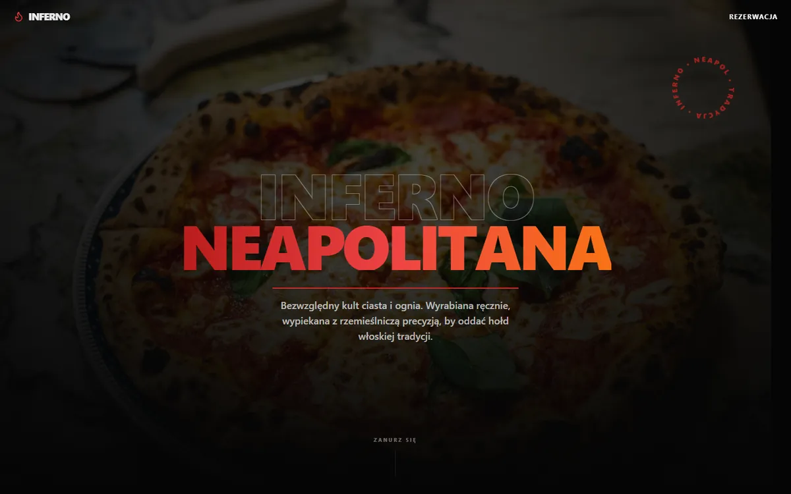
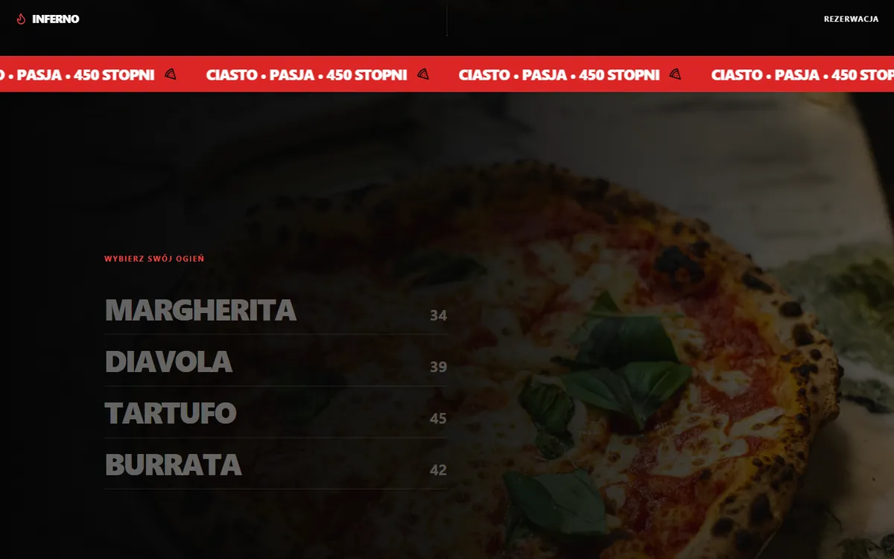
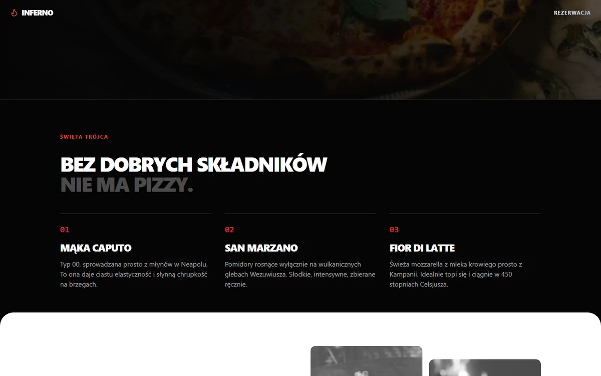
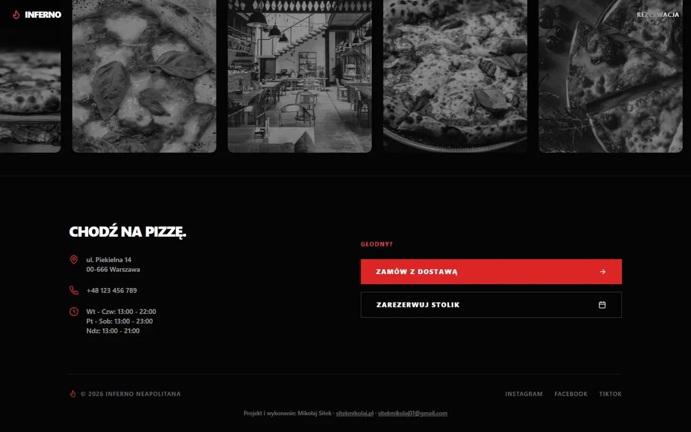
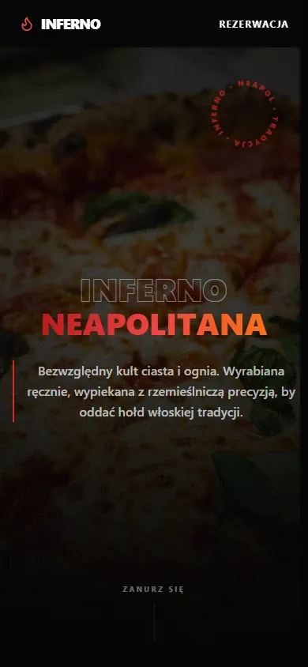
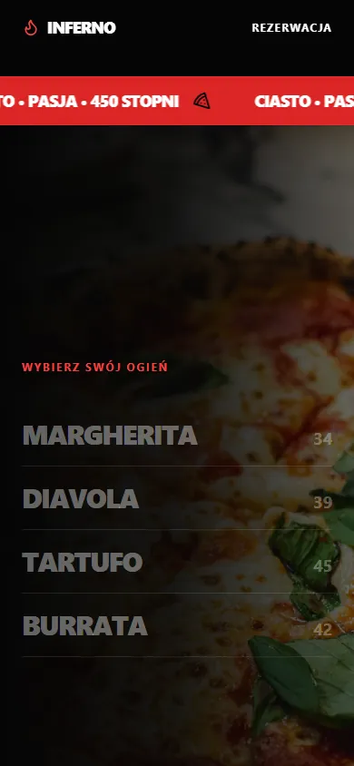
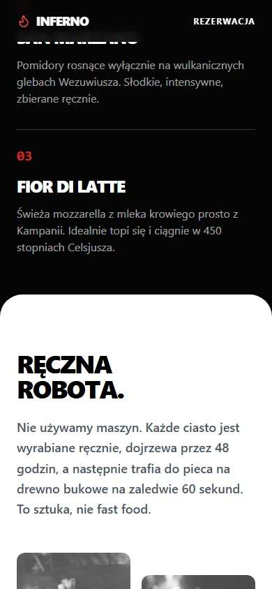

# Inferno Neapolitana

**Jednostronicowa strona pizzerii neapolitańskiej z kartą pizzy, prezentacją składników i kontaktem.**

**Strona: [inferno-pizza.vercel.app](https://inferno-pizza.vercel.app)**

Pizzeria jest fikcyjna — to demo z przykładowymi danymi kontaktowymi.



## Po co to jest

Gość może obejrzeć pizzę, sprawdzić składniki i ceny, a następnie znaleźć adres
oraz godziny otwarcia. Motyw pieca i ręcznego wyrabiania ciasta łączy sekcje strony.

- **Karta pizzy:** nazwy, składniki i ceny; wskazanie pozycji zmienia zdjęcie w tle karty.
- **Składniki i ręczna robota:** osobne sekcje o produktach i przygotowaniu ciasta.
- **Kontakt:** adres, telefon i godziny otwarcia w dolnej części strony.
- **Galeria:** zdjęcia pizzy i lokalu uzupełniają informacje o miejscu.
- **Media społecznościowe:** odnośniki prowadzą do stron głównych Instagrama, Facebooka
  i TikToka; demo nie ma podpiętych profili lokalu.

| **Karta pizzy z cenami** | **Prezentacja składników** |
|---|---|
|  |  |
| **Kontakt i godziny otwarcia** | |
|  | |

### Na telefonie

| **Start** | **Karta pizzy** | **Ręczna robota** |
|---|---|---|
|  |  |  |

## Co jest w środku

**Front:** Next.js z App Routerem, React, JavaScript, Tailwind CSS i ikony lucide-react.
Treść karty i adresy zdjęć znajdują się w `app/page.js`.

**Ruch w sekcji głównej:** tło reaguje na położenie myszy, a tekst przesuwa się
i zanika podczas przewijania. Nasłuchy zdarzeń są usuwane przy odmontowaniu komponentu.

**Animacje sekcji:** IntersectionObserver steruje klasami widoczności zdjęć.
Zmiana fotografii w karcie korzysta ze stanu Reacta i przejść CSS.

**Podgląd udostępniania:** metadane Open Graph w `app/layout.js`, obraz podglądu
w `app/opengraph-image.js` oraz własna ikona SVG w `app/icon.svg`.

## Uruchomienie

```bash
npm install
npm run dev        # serwer deweloperski
npm run build      # build produkcyjny Next.js
npm run start      # uruchomienie po wykonaniu builda
```

## Struktura

```text
app/
  page.js             sekcje strony, karta pizzy i interakcje
  globals.css         style globalne i animacje
  layout.js           układ dokumentu i metadane
  opengraph-image.js   obraz podglądu linku
  icon.svg            ikona strony
docs/zrzuty/          zrzuty na komputerze i telefonie
```

Licencja: MIT

---

Projekt i wykonanie: **Mikołaj Sitek** · [sitekmikolaj.pl](https://sitekmikolaj.pl) · [sitekmikolaj01@gmail.com](mailto:sitekmikolaj01@gmail.com)
